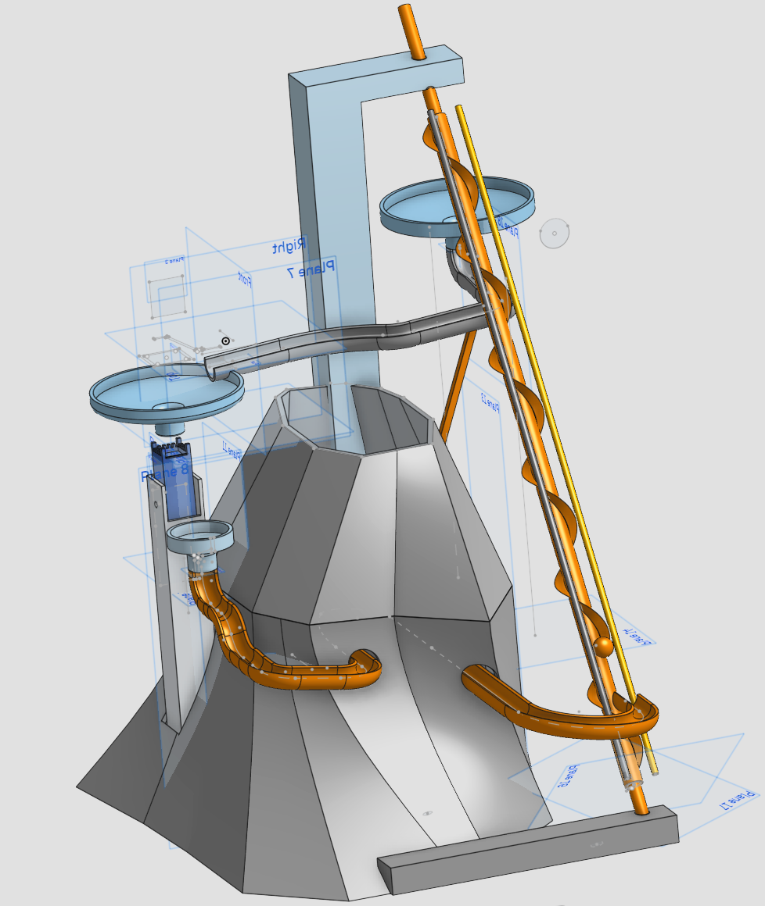
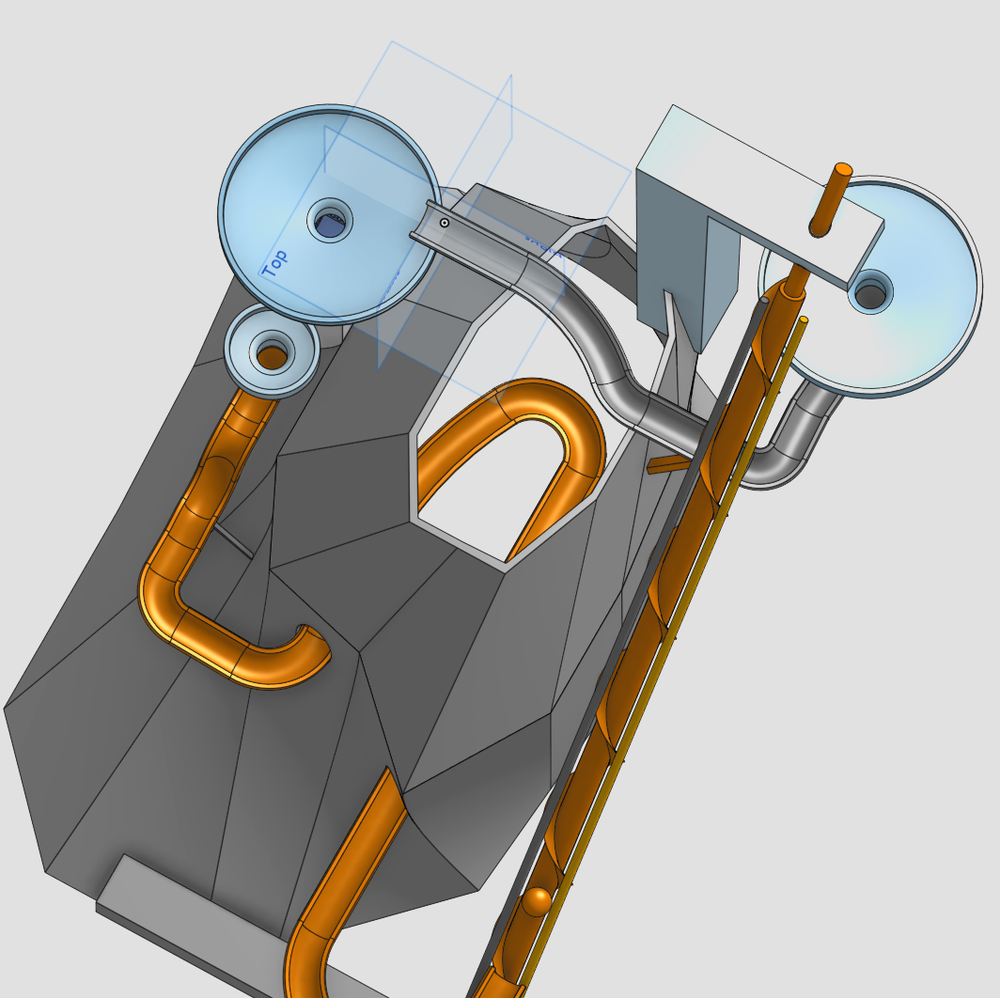
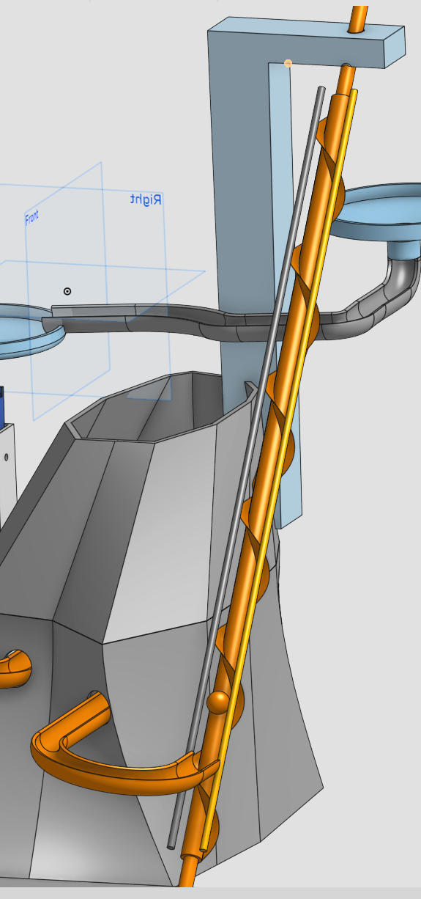
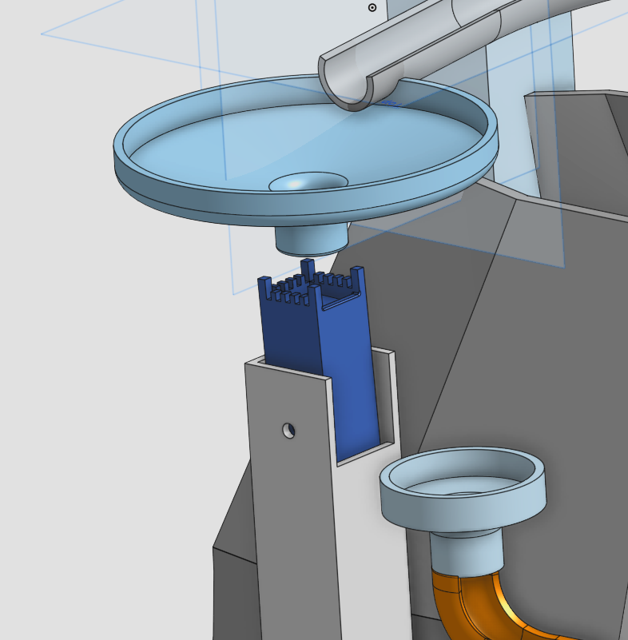

# Volcano-Marble-run
This is a simple marble run that I designed for the second week of the Half Life Hack Club challenge. 

## Overview:

Here is an overview of the course:

Here is a picture from the top, allowing you to see the inside of the mountain:

## Interesting Parts:

### Screw:

This screw should be able to move the marble up by rotating. 
It happens because the marble is stuck between the two sticks.

### Funnel and "Hammer":

Here is a simple funnel which drops the ball on a new and original part, that I call "the Hammer".
The top of the hammer is tilted so the marble should roll towards front wall. The piece becomes unbalanced, causing it to rotate and drop the ball in a second funnel.

## What I learned:

This project taught me 3D modeling. Before this I had never used a CAD software. 
